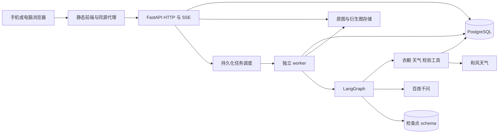

# 架构设计

版本：0.7。更新日期：2026-10-26。P1–P5 已实现，P5 运行和备份限制见 [P5](docs/P5.md)；真实搭配、照片识别与和风账号已有小样本验收；当前证据见 [DEVELOPMENT](docs/DEVELOPMENT.md)。实际交付见 [P1](docs/P1.md)、[P2](docs/P2.md)、[P3](docs/P3.md)，P4 实现见 [P4](docs/P4.md)，文档审查记录见 [REVIEW](docs/REVIEW.md)。

产品行为见 [PRODUCT](docs/PRODUCT.md)，字段和协议见 [CONTRACTS](docs/CONTRACTS.md)，实施状态见 [DEVELOPMENT](docs/DEVELOPMENT.md)。本文是技术栈和模块边界的主要维护位置。

## 1. 技术基线

### 前端

| 分类 | 技术 | 职责 |
|---|---|---|
| 核心 | React 19、TypeScript 6 | 组件与严格类型检查 |
| 构建 | Vite 8、Node.js 24 LTS | 开发、构建 |
| 路由 | React Router 7 | SPA 路由、布局、错误边界 |
| 服务端状态 | TanStack Query 5 | 服务端数据请求、缓存和失效 |
| UI | Tailwind CSS 4、shadcn/ui（Base UI）、Lucide | 样式、组件、图标 |
| 表单 | React Hook Form、Zod 4 | 草稿、校验、响应及事件验证 |
| 流式通信 | fetch、SSE、eventsource-parser | 任务订阅及事件解析 |
| 测试 | Vitest、Testing Library、MSW、Playwright | 单元、组件、模拟和端到端验证 |

前端采用 npm 与一个 `package-lock.json`，已验证安装和构建。类型生成工具使用独立 npm workspace 解决其 TS 5 peer 约束，应用仍使用 TS 6；说明见 P1。

### 后端与部署

| 分类 | 技术/方案 | 职责或状态 |
|---|---|---|
| 语言/API | Python 3.13、FastAPI、Uvicorn | API 与运行 |
| 校验/配置 | Pydantic 2、pydantic-settings | 接口、模型和环境边界 |
| 数据访问 | SQLAlchemy 2.x、Psycopg 3 | 业务事务及 PostgreSQL 连接 |
| 数据库/迁移 | PostgreSQL、Alembic | 业务持久化和结构升级 |
| Agent | LangGraph StateGraph | 单 Agent 工作流 |
| 检查点 | PostgreSQL Checkpointer | 单会话图状态持久化 |
| 模型 | 百炼官方 API、`qwen3-vl-plus` | 识别与搭配分别配置；同模型起步 |
| 长期偏好 | PostgreSQL 普通业务表 | 用户明确维护；不使用 Mem0 |
| 外部请求 | HTTPX | 百炼、和风天气及测试 |
| 天气 | 和风天气 QWeather | 中国大陆城市搜索、天气、手动降级 |
| SSE | sse-starlette | 服务端事件发送 |
| 图片 | Pillow、pillow-heif、rembg/u2netp（本地 CPU） | 原图保留、衍生图、去背景 |
| Excel | `.xlsx` v1 模板；openpyxl、defusedxml | 嵌入图、行映射与字段校验 |
| 后台任务 | 独立 worker、PostgreSQL Job 表与 SKIP LOCKED | P1 已验证领取、租约、幂等及中断；决策见 P1/D-09 |
| 文件 | 本地文件系统与持久化挂载 | 图片、临时导入和备份 |
| 工具 | uv、Ruff、mypy | 依赖、格式及类型检查 |
| 测试 | pytest、pytest-asyncio、HTTPX、RESPX、Fake Provider | 可重复离线验证与真实集成 |
| 部署 | Docker Compose | 静态前端/API/worker/PostgreSQL |
| 后续 | Capacitor、pgvector | 套壳与向量能力预留，首版不实现 |

P1 已固定 Node 24.19.0、Python 3.13.14、PostgreSQL 18.4、uv 0.12.7、Nginx 1.28.2；包补丁版本以 npm/uv 锁文件为准。已验证 macOS arm64 本地构建及 Linux arm64 容器。P2 已验证合成 HEIC、真实 rembg 推理与模板往返；真实手机/Excel 客户端样例仍待补验。

## 2. 运行与模块边界



- API 与 worker 来自同一个 `backend/` 项目，按角色启动。前后端是两个代码目录，不限制容器数量。
- 浏览器只调用本应用后端；Node 用于前端开发和构建。后端图状态、模型密钥和业务规则不放入浏览器。
- 前端与 `/api/v1` 同源，避免硬编码局域网地址；P1 使用 Nginx 代理，关闭 SSE 缓冲并动态解析 API 容器地址。
- 当前 HTTP 局域网阶段不强制定位成功；可请求定位则请求，失败或不支持则选择城市。可信 HTTPS 后续配置。
- 当前单人版本按可信电脑/家庭局域网使用设计；不是具有账号隔离的公开互联网服务。若部署目标改变，补充后端认证后再开放。

## 3. 数据模型

下表是完整业务逻辑模型。P1 仅创建 system_state、jobs、job_events 及检查点设施；Profile 的稳定 owner/data_epoch 暂由 system_state 承载。P2 已创建衣橱/媒体/导入表，P3 已创建 profiles/weather_cities/weather_cache。P4 已创建 outfit_sessions/outfit_revisions/outfit_messages/outfit_images/outfit_model_calls，profiles 保存 current_session_id；owner/data_epoch/demo_seeded_at 仍由 system_state 持有。P5 追加 favorites/wear_records 与历史可见性元信息；备份恢复控制记录位于独立 control_data 卷。P6 追加 recognition_calls 识别调用账本及 import_rows.analysis_notes，配置、预算和恢复语义见 [P6 识别](docs/P6-recognition.md)。

| 实体 | 关键内容 | 约束 |
|---|---|---|
| Profile | 唯一默认用户、长期偏好、默认城市、current_session_id、demo_seeded_at | 无注册入口；稳定 owner_id；记录已播种状态，不能凭衣橱为空重新生成示例 |
| Taxonomy / Tag | 品类、统一属性词表、预设/自定义标签 | 基础词表有稳定代码；自定义标签独立 |
| Garment | owner_id、品类、可选属性、状态、媒体引用、version | 图片及品类必填；软删除；默认 available |
| custom_tag_ids（P2） | Garment JSONB 内标签 UUID 关系 | 服务校验存在性、删除同步移除；未建独立 GarmentTag 表，演进边界见 P2 |
| MediaAsset | 存储键、哈希、MIME、尺寸、原件/衍生关系 | 存储键由后端生成；原件不可被转换覆盖 |
| ImportBatch / ImportRow | 来源、草稿、version、touched_fields、校验、处理状态、已确认衣服 ID | 晚到 AI 不能覆盖人工修改；一个有效行最多创建一件衣服 |
| OutfitSession | 当前需求、锁定条件、选定结果、current_job_id、候选列表、version | 映射单独的 LangGraph thread_id；首页从当前会话指针恢复 |
| OutfitMessage | 会话、已发送文本、角色、Job/revision 引用 | 保存最终回复和澄清；流式片段不当独立消息 |
| OutfitRevision | 生成批次/父版本、单品快照、说明、未满足条件、hidden_from_history_at | 内容不可变；历史隐藏独立；一批最多三套；调整创建新版本 |
| OutfitItemSnapshot | 当时属性、当时展示图引用、可选 garment_id | 删除或修改 Garment 不修改此快照 |
| Favorite | 对某 OutfitRevision 的收藏与名称 | 收藏固定版本；不是“当前最新搭配”的浮动引用 |
| WearRecord | 日期、OutfitRevision、备注 | 用户明确记录；生成和收藏不自动写日历 |
| Job / JobEvent | kind、请求哈希、幂等键、租约、状态、步骤、事件序号、分类型结果引用 | 状态持久化；事件单调递增并唯一；重放检查业务提交标记 |
| WeatherCache | 城市/坐标、预报时间、获取时间、来源、到期时间 | 明确区分当前实况与未来预报 |
| Agent checkpoints | 图状态和适配器元数据 | 独立 schema，不充当衣橱/历史的事实来源 |

数据库在外键、唯一约束和事务层落实幂等与关系完整性。所有权预留仅是结构准备，不能宣称首版已实现多用户安全隔离。

### 删除与图片生命周期

Garment 删除后从当前衣橱和候选查询排除。快照保留当时的图片引用，且该引用禁止被衣服删除级联清理。原图/去背景显示选择发生变化时，新的快照引用新的选择，旧快照不变。

临时导入资产和无人引用的媒体可按明确的保留策略清理。垃圾回收必须检查衣服、导入行、快照及备份过程中的引用；首版可保守不自动删除，不能为了省空间破坏历史。

## 4. 导入与图像工作流

P2 的持久化、媒体卷、幂等回执和具体重试边界见 [P2](docs/P2.md)。其余实体随对应业务阶段建立。

```text
Excel → 模板/嵌入图/字段解析 ─┐
                           ├→ ImportRow 草稿 → 公共审核表格 → 确认 → Garment
照片 → 原件保存/格式转换 → AI ┘
                 └→ 去背景任务 → 可选择的衍生图
```

- Excel 入口按已填属性导入，不默认触发识别，也不自动覆盖标签；基础类型转换与字段验证可以执行。
- 两条入口均经过原件保存、标准格式转换和去背景；上图的去背景分支也适用于 Excel 提取的图片。
- 照片入口一图一行，AI 只预填。单行识别失败不阻塞别的行，可重试或人工填写。
- 记录人工修改字段和行版本，晚到识别只填仍为空且未被人工触碰的字段；确认后不再改衣服属性。后台衍生图不会覆盖用户已选择的显示方式。
- 图片转换或去背景失败时展示明确状态，已有可显示的原图/标准图仍可使用。HEIC 原件可能不能由浏览器直接显示，“原图视图”可用保留原貌的标准格式衍生图实现，原始文件仍保存。
- 云端识别使用必要的标准衍生图，保留原件不代表必须把原件、EXIF 和全部像素发给模型。
- 平铺、挂拍和鞋的一双照片是输入范围；去背景不是人物服饰分割。
- Excel 只接受模板约定的图片表示法。浮动嵌入图、现代单元格图片及 IMAGE 公式不是同一种文件结构；首版优先验证本项目模板产生的锚定嵌入图，其余必须给出兼容性错误，不静默错配。

## 5. Agent 工作流

```text
解析需求与目标搭配 → 合并长期偏好和本次要求 → 读取天气/可用衣服
→ 构造候选与锁定约束 → 模型生成结构化方案 → 领域校验
→ 有限修正或返回未满足条件 → 提交不可变结果 → 发送结果事件
```

- 工具边界：读取衣橱、读取天气、读取偏好、校验候选；生成请求允许保存搭配结果。首版聊天不自动修改衣服状态、删除衣服或写实际穿着日历。
- 本次明确要求优先于长期偏好，但不能绕过“不可用单品排除”和真实性校验。
- 只换指定项时其余项自动保持；只有“重搭未锁定部分”才扩大替换范围。按钮和聊天共同使用 CONTRACTS 的 scope，不能各自解释。
- 锁定单品不因风格不符被替换。若已锁定单品随后不可用/删除，该请求不能同时满足两个硬约束，返回可解释的冲突，要求用户处理。
- 使用 Structured schema 与有限循环；所选模型是否支持某种原生 JSON/工具协议须真实探测，不能假设。
- 记录 run_id、session_id、prompt_version、模型标识、使用的天气及候选版本，使结果可追溯。
- 记忆分工：偏好在业务表；会话图状态在 Checkpointer；收藏/日历引用不可变业务快照。
- Checkpointer 只存可序列化状态与资源 ID；不放数据库 Session、HTTP 客户端、图像大字节或秘密。

## 6. 任务、事务与事件

1. 显式操作创建带幂等键的 Job；同请求重复提交取得同 Job。
2. Worker 领取任务并记录执行状态。模型或图片处理不占用长写事务。
3. 关键步骤以结构化 JobEvent 落库，SSE 从持久事件读取；心跳不当业务事件保存。
4. 普通任务的业务结果、Job 终态及对应最终事件在同一业务事务内提交，避免“已完成但查不到结果”。检查点单独提交，恢复节点须先检查 Job/业务提交标记及已保存的步骤响应，不能靠检查点猜测业务是否已保存。恢复控制任务采用下一节的独立持久记录。
5. 恢复连接查询相同 Job，不新建生成。事件过期则读取任务结果快照。
6. 进程退出后的失联运行需检测；外部请求结果未知时标记 interrupted，而不是声称 exactly-once 并自动重发。

任务预算、事件保留、取消竞争和幂等语义以 [CONTRACTS](docs/CONTRACTS.md) 为准。P4 的持久调用记录、原子结果提交、图片快照与限制见 [P4](docs/P4.md)。P1 直接以 Job 表作为持久队列，创建事务提交即可被 worker 经租约领取，没有第二个 broker/outbox 双写；完成 D-09 验证。后续若切换外部队列，须增加可靠 outbox 等投递机制。不得引入已被替换的 SQLite 作为第二套业务存储。

## 7. 备份与恢复

备份包含业务 schema、检查点 schema 的 PostgreSQL 逻辑数据和所有被引用的原件/衍生图片；不包含环境文件、服务凭据、模型缓存和早先的备份包。清单记录备份格式版本、应用版本、Alembic revision、检查点适配器版本、创建时间、文件大小和 SHA-256。单靠校验和不声称备份来自可信作者。

一致性操作顺序：

1. 创建 backup job 后进入全局维护状态，拒绝新写入和新的任务领取，暂停清理；已有 worker 运行需完成或被可靠终止且失效其租约。不能只停 API 写入而允许 worker 继续改变图片引用。
2. 在有界等待内不能静止则备份失败并退出维护，不能输出“部分一致”的备份。维护管理任务自身由独立控制路径推进，不能被普通 worker 暂停规则卡死。
3. 静止状态下导出两个 schema 和引用文件清单、复制文件、校验、原子发布备份；最后解除维护。媒体文件不可变使复制期间不会同路径变内容。
4. 恢复先在隔离位置校验并试恢复，首版只接受应用明确支持的格式/schema/适配器版本；不匹配拒绝且保留当前数据。后续兼容转换需显式版本规则，不自动猜测迁移。
5. 用户确认令牌绑定备份哈希、目标数据世代和失效时间；实际覆盖前重新校验，并建立当前数据库与文件的恢复点。
6. 暂停 API 业务写入、worker 和 Checkpointer 连接后切换数据库与图片；失败回滚到成对的恢复点，成功校验后才恢复服务。

实现：独立 controller 和共享控制卷 flock 形成全局维护屏障；恢复先保留原媒体并写入新媒体，再在一个事务中恢复两个 schema 的行数据及新世代，失败由 PostgreSQL 回滚，原媒体不受损。详细格式、接口与边界见 [P5](docs/P5.md)。

恢复控制 ID、确认状态和进度必须放在不会被目标数据库覆盖的持久控制记录中（工程默认使用专用控制目录及原子文件），以便重启后查询同一 restore_id。`backup_restore` 的 Job 是该控制状态的 API 映射，不能只靠即将被覆盖的业务 Job 表保存进度。恢复会增加 `data_epoch`；客户端丢弃旧缓存、未提交幂等操作和事件游标后重新加载。

备份中的 queued/running/cancel_requested 任务全部转为 interrupted，废弃旧租约和待投递记录，不自动重放。会话只有在用户明确继续时才重新验证衣服并恢复。维护中读取可显示旧状态但标明 maintenance；写入返回 503 `MAINTENANCE_MODE`，恢复控制接口例外。P5 使用数据格式备份、隔离验证库、不可变媒体预写及单一数据库事务切换；进程故障验证和限制见 [P5](docs/P5.md)，不宣称数据库/文件系统是同一个原子事务。

## 8. 与外部服务的边界

- 百炼和天气凭据到接入时配置，分别提供 Configured/Unconfigured/Unavailable 状态。
- 和风城市结果限中国大陆，坐标格式和行政区过滤在适配层规范化。天气字段提供来源、时效与手动覆盖标记。
- 支持请求超时、按错误类型有限重试；数据不完整和失败不能伪造成功天气或衣服属性。
- Fake Provider 用于确定性开发和测试，与真实服务有相同内部接口，但运行界面和结果来源必须区分。

## 9. 代码规模与文档演进

### 代码拆分

目录树是业务和技术职责的导航，不是“一目录对应一文件”。文件规模目标与例外统一维护在 [根 AGENTS](AGENTS.md)，前后端内部示例见各自 README。

| 层 | 允许的职责 | 依赖边界 |
|---|---|---|
| 前端 app/page | 路由、页面布局、组合功能 | app 组合 features；页面调用本域组件/hooks |
| 前端 feature | 本域交互、表单、查询和 API 适配 | 依赖共享 UI/lib/generated，不深层引用其他 feature 私有文件 |
| 前端共享层 | 通用 UI、HTTP/SSE、基础能力 | 不反向依赖 feature；业务逻辑不塞进通用工具文件 |
| 后端路由/worker | 协议映射、入口与任务生命周期 | 调用 service/Agent，不重写领域规则 |
| 后端 Agent | 图状态和编排、工具调用 | 调用业务服务/provider；graph 入口只组装流程 |
| 后端 service | 单项业务用例、事务边界 | 调用领域规则、repository、provider |
| 后端 domain | 纯业务约束 | 不依赖 HTTP 框架、数据库或模型 SDK |
| 后端 repository/provider | 存储或外部服务适配 | 不反向调用 HTTP 路由或整张 Agent 图 |

出现可独立测试的职责、不同的修改原因、复杂状态流程或跨域依赖时就应考虑拆分，不必等达到行数阈值。反之，不因一段内聚代码略长就拆出一串无意义函数转发。跨 feature 协作通过明确的公开接口或上层组合完成，避免循环依赖。

P1 已提供 scripts/check_structure.py 检查手写文件规模及静态导入方向，生成代码排除；scripts/check_docs.py 检查文档链接。脚本已运行，不等于已配置远程 CI；动态导入等复杂边界仍需评审。

### 文档逐步拆分

当前文档规模不需要立即拆成大量小文件。增长到独立主题难以定位或触发根 AGENTS 的审查阈值时，按下表迁移；docs/history/ 和 docs/adr/ 已从 P3 开始使用，其余目录按需创建。

| 入口文件 | 长期保留的内容 | 详细内容迁往 |
|---|---|---|
| `ARCHITECTURE.md` | 技术栈、系统边界、简要数据流、索引 | `docs/architecture/` 下的数据模型、Agent、任务、媒体、备份专题 |
| `docs/PRODUCT.md` | 目标、范围、稳定需求/验收 ID 索引 | `docs/product/` 下的衣橱、导入、搭配等需求专题 |
| `docs/CONTRACTS.md` | 公共约定、契约索引、版本策略 | `docs/contracts/` 下的 HTTP、任务/SSE、导入模板、备份格式专题；字段细节由可执行 schema 管理 |
| `docs/DEVELOPMENT.md` | 当前阶段、未解决问题、下一任务、阶段索引 | `docs/plans/` 的阶段任务，`docs/history/` 的历史开发记录 |
| `docs/DECISIONS.md` | 决策 ID、状态、短摘要及链接 | `docs/adr/` 中按决策分开的背景、方案和证据 |

拆分后保持每项内容只有一个权威位置，旧入口留下准确链接，保留 P/A/D 编号并修复引用。历史记录是当时证据，不能把旧的计数或运行结果改写成新的验证结果。README 不复制详细规范；AGENTS 只指明应读哪些主题，不嵌入全部实现细节。

AI 接续任务时先读概览和当前进度，再按需求 ID/接口/业务域读取专题。新的文档拆分属于实现维护，不必重新询问已确认的产品需求。

## 10. 参考

- [LangGraph 持久化](https://docs.langchain.com/oss/python/langgraph/persistence)
- [FastAPI](https://fastapi.tiangolo.com/features/)、[SQLAlchemy](https://docs.sqlalchemy.org/en/20/)、[Alembic](https://alembic.sqlalchemy.org/en/latest/)
- [百炼视觉理解](https://help.aliyun.com/zh/model-studio/vision)
- [和风城市搜索](https://dev.qweather.com/docs/api/geoapi/city-lookup/)、[和风天气文档](https://dev.qweather.com/docs/)
- [rembg 支持范围](https://github.com/danielgatis/rembg)

第三方接口与收费会变化，接入时重新核实。本文不承诺未知账号权限、机器性能、模型效果或长期免费额度。
